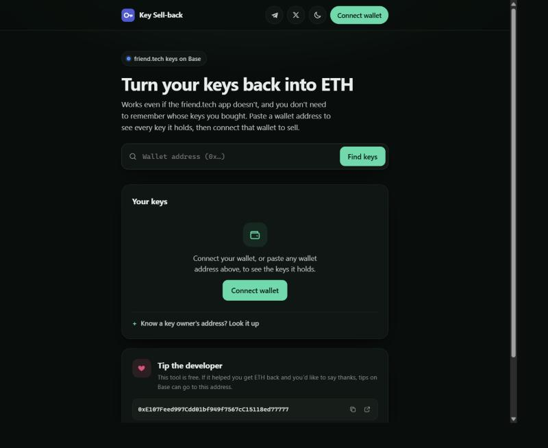

# Key Sell-back

**Sell your friend.tech keys on Base for ETH, straight from your wallet. Works even if the friend.tech app doesn't.**

**Live:** https://key-sell-back.pages.dev



Paste any wallet address to see every friend.tech key it holds and what each is worth. Connect that wallet to sell
one position, or all of them, back to the friend.tech contract. You don't need to remember whose keys you bought.

> Not affiliated with friend.tech. An independent, open-source tool that calls the public friend.tech contract
> on Base. Use at your own risk.

## Features

- **Find every key without the owners' addresses.** Keys can't be transferred, so every key a wallet holds came
  from a `buyShares` call that wallet sent. The app reads the wallet's history and finds them all.
- **Search any wallet.** No wallet connection is needed to look. Share a link with `?wallet=0x…`.
- **See what it's worth.** Each position shows its sell value after fees, with a total for the wallet.
- **Sell one, or sell all.** Pick an amount, or sell every sellable position in one guided run: one wallet
  confirmation per key owner, with progress, Stop, and a summary.
- **Checked before you sign.** Every sale is simulated first, and wrong-network and wrong-account cases are caught.
- **Light and dark themes**, a mobile layout, and reduced-motion support.

## How to use it

1. Open the site in a browser with a wallet extension (MetaMask, Rabby, Coinbase Wallet, …).
2. Click **Connect wallet**, or paste a wallet address into the search box.
3. Pick a key owner from the list, choose an amount (it defaults to the most you can sell), and press **Sell**.
   Or press **Sell all**.
4. Confirm in your wallet. The ETH arrives in the same wallet, minus friend.tech's fees and a little gas.

The contract never lets anyone sell a person's **last** key, so a position that holds only that key shows as
"last key, can't sell".

## Safety

- **No keys, no seed phrases, no backend.** It's static HTML and JavaScript. Every transaction is built in the
  browser and signed in your own wallet.
- **Only sells to the friend.tech contract** (`0xCF205808Ed36593aa40a44F10c7f7C2F67d4A4d4`), and simulates
  `sellShares` before asking you to sign.
- **Locked-down page.** The Content-Security-Policy allows scripts only from the site itself. Network calls go
  only to public Base RPC endpoints, the Blockscout explorer API, and your wallet.
- **Pinned dependency.** ethers v6.13.4 is vendored and loaded with Subresource Integrity.

## Run locally

No build step. Wallet extensions don't inject into `file://` pages, so serve the folder over HTTP:

```bash
python -m http.server 8766 --bind 127.0.0.1
```

Then open http://localhost:8766. Deep links: `?wallet=0x…` lists a wallet's keys, and `?subject=0x…` opens one
key owner.

## Deploy

Upload the folder to any static HTTPS host (Cloudflare Pages, GitHub Pages, Netlify, …). With Cloudflare Pages:

```bash
npx wrangler pages deploy . --project-name <your-project>
```

`_headers` adds security headers on Cloudflare Pages. Other hosts ignore it.

## How it works

| Step | What happens |
| --- | --- |
| Find keys | Reads the wallet's sent transactions from Blockscout (up to 10,000), collects every key owner from `buyShares` / `sellShares` calls, plus the wallet itself |
| Check balances | Reads `sharesSupply` and `sharesBalance` for every owner, batched through [Multicall3](https://www.multicall3.com/) so a large wallet takes a handful of RPC requests |
| Price | `getSellPrice` and `getSellPriceAfterFee` for the sellable amount, `min(balance, supply - 1)` |
| Sell | Switches the wallet to Base, simulates `sellShares(subject, amount)`, then sends it |
| Sell all | One `sellShares` per key owner (the contract sells one owner's keys per call), each re-read and simulated right before it's sent |

Reads rotate across free public Base RPC endpoints, with retries and backoff when one rate-limits.

## Project structure

| Path | Purpose |
| --- | --- |
| `index.html` | Markup, icon sprite and Content-Security-Policy |
| `styles.css` | Theme tokens (light/dark) and layout |
| `js/config.js` | Contract address, Base chain settings, RPC endpoints, ABI, tip address |
| `js/chain.js` | RPC reads, Multicall3 batching, Blockscout scan, wallet and sell transaction (no DOM) |
| `js/app.js` | State, rendering and event handlers |
| `js/theme.js` | Applies the saved theme before first paint |
| `vendor/ethers-6.13.4.umd.min.js` | [ethers](https://github.com/ethers-io/ethers.js) v6, MIT (see `vendor/ethers.LICENSE`) |
| `_headers` | Security headers for Cloudflare Pages |

## Limitations

- Only the most recent 10,000 transactions a wallet sent are scanned. The app says so when a history is longer,
  and you can still look up a key owner by address.
- Keys bought through a smart-contract wallet are only found when you search that contract wallet's address.
- It relies on free public RPCs and Blockscout. Under heavy load, scans slow down while they retry.

## Support

This tool is free. If it helped you get ETH back, tips on Base are welcome at
`0xE107Feed997Cdd01bf949f7567cC15118ed77777`.

[Telegram](https://t.me/Stoicfarmer) · [X](https://x.com/st0icfarmer)

## License

[MIT](LICENSE)
